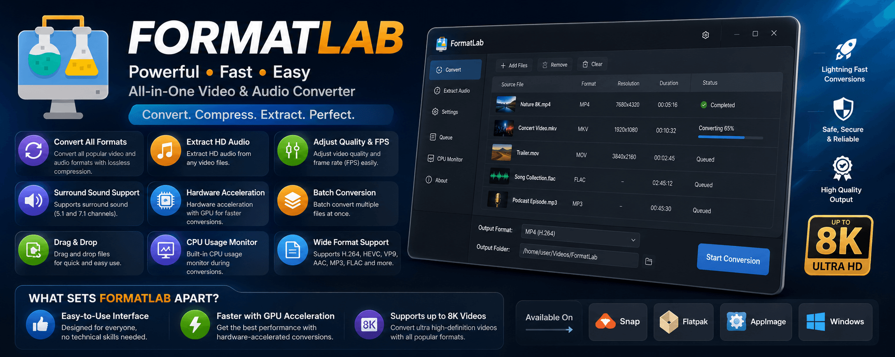
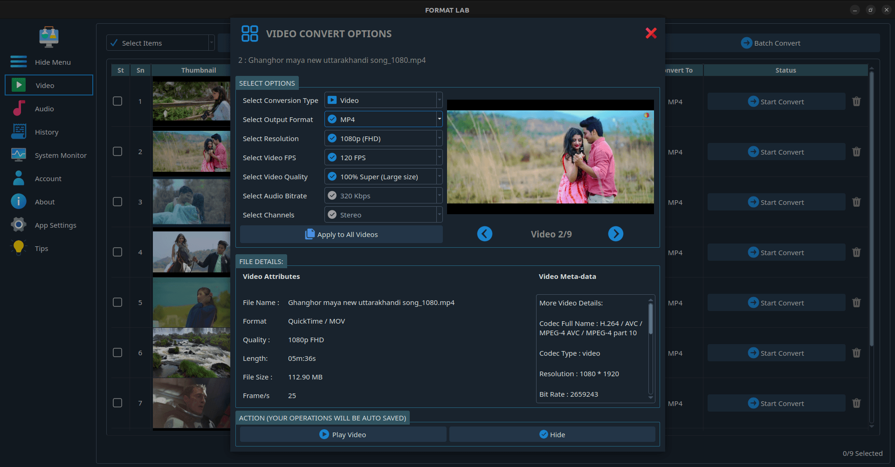
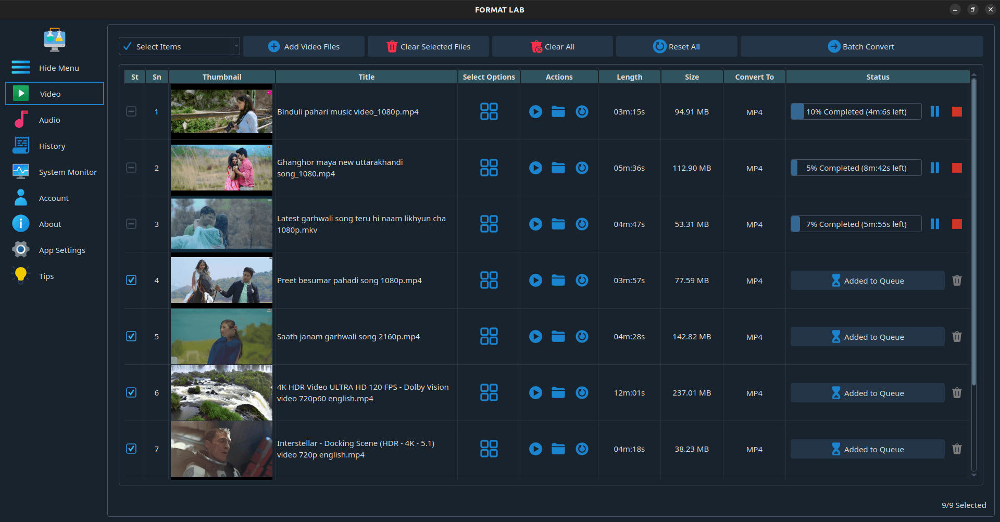
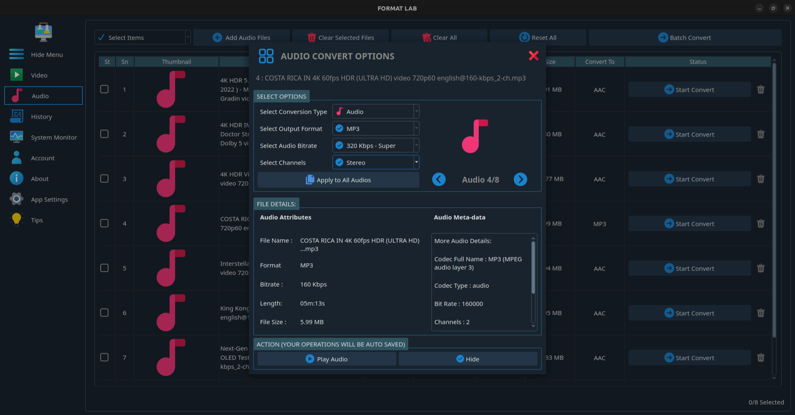
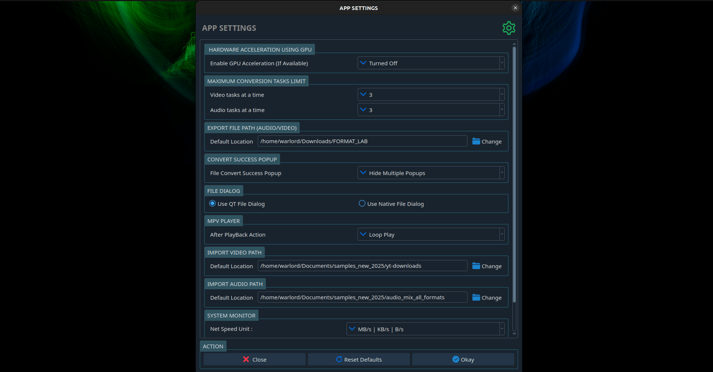

# FormatLab: video and audio converter for Linux and Windows

FormatLab is a desktop video and audio converter for Linux and Windows. It converts MP4, MKV, MOV, AVI, WebM, MP3, FLAC, WAV and 40+ other formats, with GPU-accelerated encoding, batch conversion and drag and drop. It has no ads and no watermarks, and it never uploads your files: everything is converted on your own machine.

<p align="center">
  
</p>

<p align="center">
  <a href="https://flathub.org/apps/details/com.warlordsoftwares.formatlab"></a>
  <a href="https://snapcraft.io/formatlab"></a>
  <a href="https://github.com/rishabh3354/FORMAT_LAB/releases/latest"></a>
</p>

<p align="center">
  
  
  
  
</p>

> Used by 76,000+ people on Flathub alone.

## Contents

- [Download and install](#download-and-install)
- [Why use FormatLab](#why-use-formatlab)
- [Supported formats](#supported-formats)
- [Common conversions](#common-conversions)
- [Screenshots](#screenshots)
- [System requirements](#system-requirements)
- [FAQ](#faq)
- [How FormatLab compares](#how-formatlab-compares-to-other-video-converters)
- [More apps](#more-apps-by-warlord-softwares)

## Download and install

<p align="center">
  <a href="https://snapcraft.io/formatlab"></a>&nbsp;
  <a href="https://flathub.org/apps/details/com.warlordsoftwares.formatlab"></a>&nbsp;
  <a href="https://github.com/rishabh3354/FORMAT_LAB/releases/latest"></a>&nbsp;
  <a href="https://github.com/rishabh3354/FORMAT_LAB/releases/latest"></a>
</p>

### Install on Linux (terminal)

```bash
sudo snap install formatlab
```

```bash
flatpak install flathub com.warlordsoftwares.formatlab
```

### Install on Linux (AppImage, any distro)

Download the latest `.AppImage` from the [releases page](https://github.com/rishabh3354/FORMAT_LAB/releases/latest), then:

```bash
chmod +x FormatLab-x86_64.AppImage
./FormatLab-x86_64.AppImage
```

### Install on Windows

Download the Windows installer from the [releases page](https://github.com/rishabh3354/FORMAT_LAB/releases/latest) and run it. It supports 64-bit Windows 10 and Windows 11.

## Why use FormatLab

- Convert video and audio between MP4, MKV, MOV, AVI, WebM, MP3, FLAC, WAV, AAC and more, using current, widely supported codecs.
- Encode on NVIDIA, AMD or Intel GPUs, which makes large conversions much faster than CPU-only tools.
- Queue dozens of files, or a whole folder, and convert them in one run.
- Pull a clean MP3, FLAC or WAV track out of any MP4, MKV or MOV file.
- Shrink 4K and 1080p video by choosing the bitrate, CRF quality and frame rate, without wrecking the picture.
- Convert source files up to 8K, including high frame rate material.
- Keep 5.1 and 7.1 surround sound instead of a forced downmix to stereo.
- Drop files onto the window to queue them.
- Watch CPU load in the built-in monitor, so a long encode doesn't freeze the rest of your desktop.
- Convert offline. Your files never leave your computer, and there are no upload limits like browser-based converters have.
- No ads, no watermarks, no tracking.

## Supported formats

### Video formats

| | | | |
|---|---|---|---|
| MP4 | MKV | MOV | AVI |
| WebM | WMV | FLV | MPEG |
| MPG | M2TS | 3GP | VOB |
| TS | OGV | F4V | MXF |
| ASF | HEVC | M2V | MTS |
| WTV | | | |

### Audio formats

| | | | |
|---|---|---|---|
| MP3 | AAC | WAV | FLAC |
| M4A | OGG | WMA | Opus |
| AIFF | DTS | AC3 | MP2 |
| VOC | RA | TTA | WV |
| CAF | M4R | | |

### Codecs

- Video: H.264 / AVC, H.265 / HEVC, VP9, MPEG-4, MPEG-2
- Audio: AAC, MP3, FLAC, Opus, Vorbis, AC3, PCM

## Common conversions

| Task | What FormatLab does |
|---|---|
| Convert MKV to MP4 | Remux or re-encode MKV into an MP4 that plays anywhere |
| Convert video to MP3 | Extract the audio track and save it as high-bitrate MP3 |
| Convert MOV to MP4 | Turn iPhone and camera MOV files into MP4 you can share |
| Convert AVI to MP4 | Re-encode old AVI footage to H.264 or HEVC |
| Convert WebM to MP4 | Make downloaded WebM clips play in any editor or player |
| Convert MP4 to HEVC (H.265) | Cut file size roughly in half at the same visual quality |
| Convert FLAC to MP3 | Shrink a lossless music library for phones and car stereos |
| Convert WAV to MP3 | Compress raw recordings without noticeable quality loss |
| Compress a 4K video | Lower bitrate, resolution or frame rate to hit a target size |
| Extract audio from a video | Save MP3, FLAC, WAV, AAC or Opus from any video file |
| Change video frame rate (FPS) | Convert 60fps to 30fps, or match a project's timeline |
| Convert a whole folder at once | Queue every file and convert them one after another |

## Screenshots

| Video conversion options | Home screen |
|---|---|
|  |  |

| Audio conversion options | Settings |
|---|---|
|  |  |

## System requirements

| | Minimum |
|---|---|
| Linux | Ubuntu 20.04+, Debian 11+, Fedora 36+, Arch, or any distro that runs Flatpak / Snap / AppImage |
| Windows | Windows 10 or Windows 11, 64-bit |
| Architecture | x86_64 |
| RAM | 4 GB (8 GB recommended for 4K) |
| GPU acceleration | Optional: NVIDIA, AMD or Intel GPU with current drivers |

## FAQ

### Is FormatLab free?

FormatLab is free to download and use for everyday conversions. A one-time Pro upgrade unlocks unlimited batch queues and every other feature. There is no subscription. See [plans and pricing](https://warlordsoftwares.com/apps/plans-and-pricing/).

### Does FormatLab upload my files anywhere?

No. FFmpeg converts everything on your own machine. There is no upload, no file size cap and no server-side queue, so it works offline and is safe for confidential footage.

### Does FormatLab work on Ubuntu, Fedora and Arch?

Yes. Install it as a Snap, as a Flatpak from Flathub, or as a portable AppImage that runs on almost any current Linux distribution.

### Can it convert 4K and 8K video?

Yes. FormatLab handles source files up to 8K, and GPU acceleration keeps large UHD encodes to a reasonable time.

### Can it convert multiple files at once?

Yes. Drag in a whole folder, set the output format once, and FormatLab converts the whole queue.

### Does it keep 5.1 or 7.1 surround sound?

Yes. It keeps multi-channel audio instead of downmixing it to stereo.

### Does converting lose quality?

Any lossy re-encode loses some quality. FormatLab has bitrate and quality controls so you can keep the result visually lossless, and a container change (for example MKV to MP4) can often skip re-encoding the video stream.

### Is FormatLab open source?

No. FormatLab is a proprietary desktop application built on FFmpeg. This repository holds the releases, packaging metadata, issue tracker and documentation. The application source is not here.

### How do I report a bug or request a feature?

Open an [issue](https://github.com/rishabh3354/FORMAT_LAB/issues) on this repository.

## How FormatLab compares to other video converters

- Online converters (Zamzar, CloudConvert, Online-Convert) cap file sizes, upload slowly, and keep your media on someone else's server. FormatLab converts locally with no size limit.
- HandBrake is excellent and free, but it focuses on video transcoding and its interface is dense. FormatLab also covers audio formats and keeps the workflow simpler.
- Raw FFmpeg can do everything, but you have to know the flags. FormatLab puts a graphical front end on the same engine.
- Paid Windows converters (Movavi, VideoProc, Wondershare UniConverter, HitPaw) charge a subscription and support Windows first. FormatLab is a one-time purchase and supports Linux as fully as Windows.

## More apps by Warlord Softwares

Other apps by Warlord Softwares are listed on [warlordsoftwares.com](https://warlordsoftwares.com/).

## Links

- Website: [warlordsoftwares.com](https://warlordsoftwares.com/trending-apps/formatlab-pro-convert-or-compress-video-audio-formats-one-click/)
- Flathub: [com.warlordsoftwares.formatlab](https://flathub.org/apps/details/com.warlordsoftwares.formatlab)
- Snap Store: [snapcraft.io/formatlab](https://snapcraft.io/formatlab)
- Issues: [github.com/rishabh3354/FORMAT_LAB/issues](https://github.com/rishabh3354/FORMAT_LAB/issues)
- Privacy policy: [privacy.html](https://warlordsoftwares.com/privacy-policy/)

## License

FormatLab is proprietary software. © 2024–2026 Rishabh Bhardwaj / Warlord Softwares. See [LICENSE](LICENSE).

FormatLab uses [FFmpeg](https://ffmpeg.org/) for media processing.
